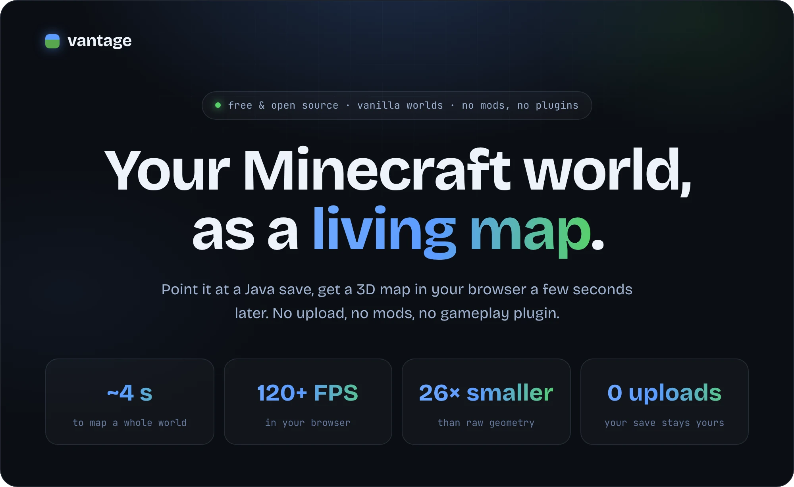
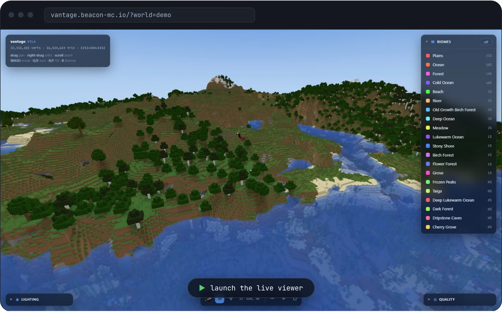
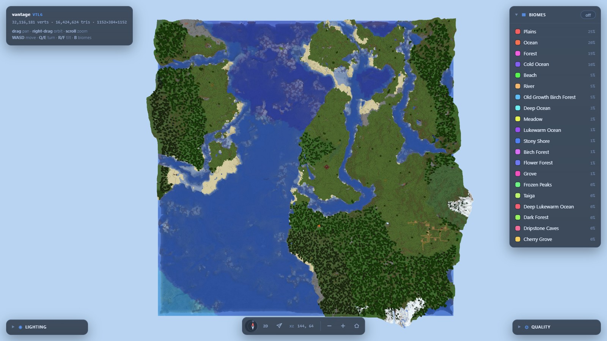
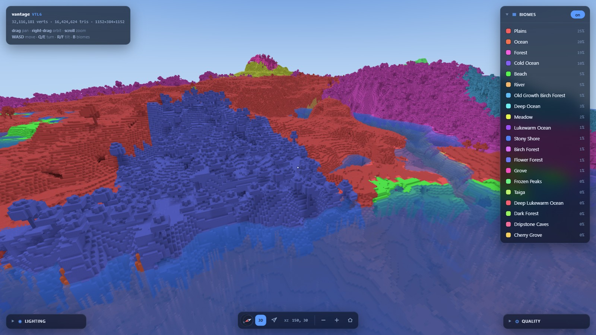
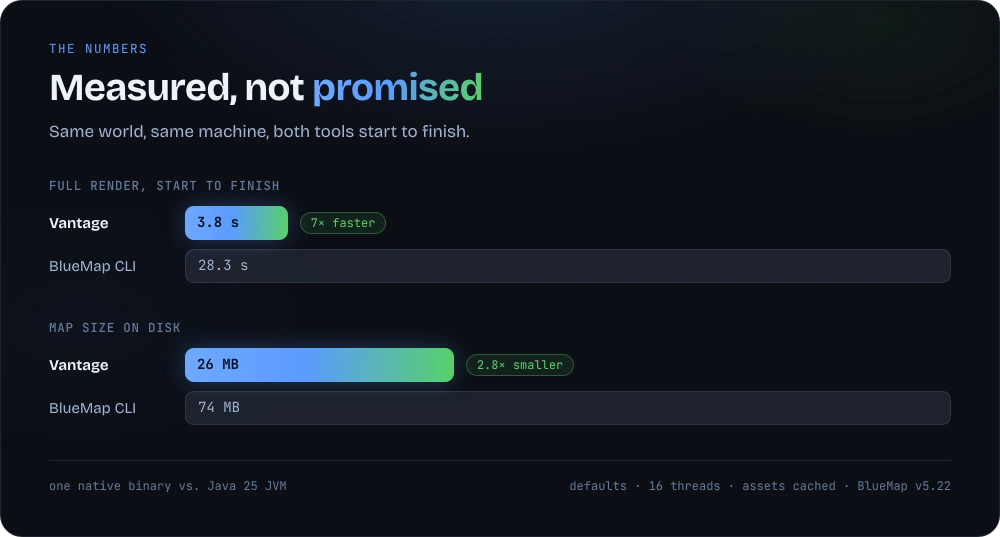
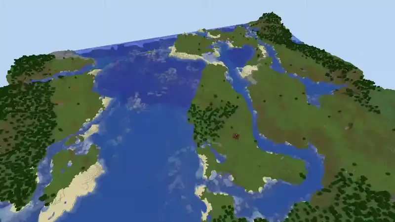
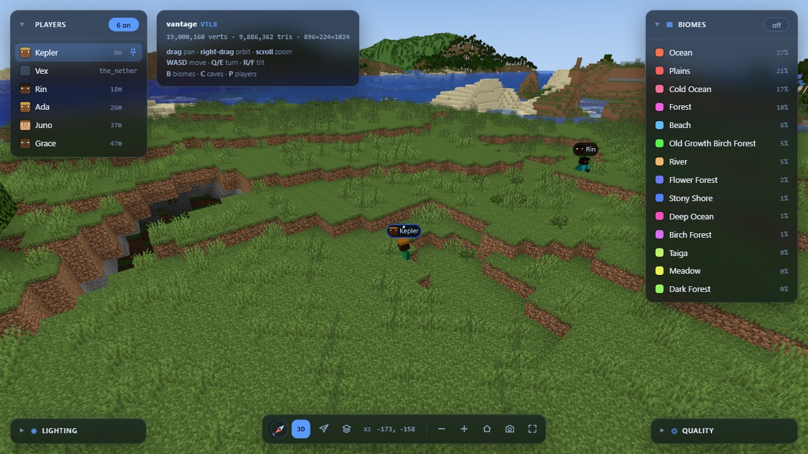
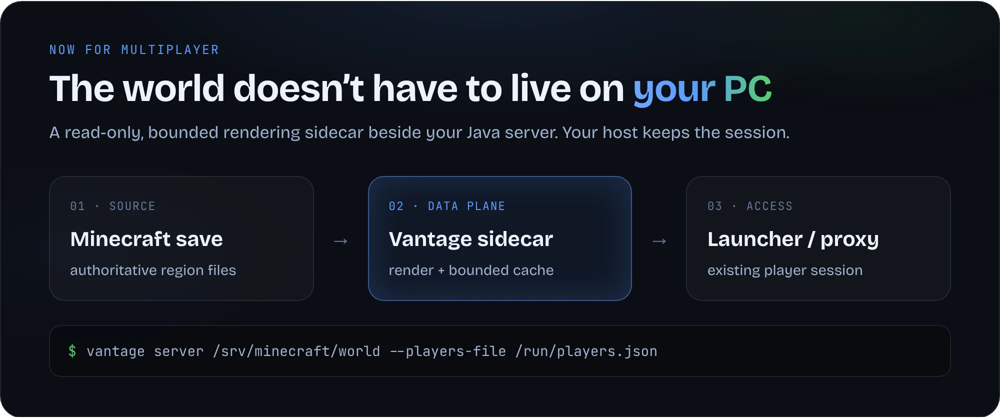

<div align="center">

<a href="https://vantage.beacon-mc.io">
  
</a>

<br />

[](https://github.com/thoughts-on-things/vantage-mc/actions/workflows/ci.yml)
[](https://github.com/thoughts-on-things/vantage-mc/releases/latest)
[](https://www.npmjs.com/package/@thoughts-on-things/vantage-mc)
[](./LICENSE)

**[Live demo](https://vantage.beacon-mc.io/?world=demo)** ·
**[Download](https://vantage.beacon-mc.io/#desktop)** ·
[Quick start](#quick-start) ·
[Multiplayer](#multiplayer) ·
[Web viewer](./web/README.md) ·
[Website](https://vantage.beacon-mc.io)

</div>

<br />

<a href="https://vantage.beacon-mc.io/?world=demo">
  
</a>

<p align="center"><sub>That's the live viewer, not a video. Click it to fly around the demo world.</sub></p>

## Choose your path

| I want to… | Start here |
| --- | --- |
| 🖥️ **Map worlds on my computer** | [Download Vantage Desktop](https://vantage.beacon-mc.io/#desktop) for Windows, macOS or Linux |
| 🌐 **Explore a multiplayer server's map** | Vantage Desktop → **Servers** → the address your admin gave you ([details](./docs/server.md#connecting-from-vantage-desktop)) |
| ⌨️ **Render or host maps from the command line** | [Grab the CLI](https://github.com/thoughts-on-things/vantage-mc/releases/latest), then follow the [quick start](#quick-start) |
| 🧩 **Add the viewer to a web app** | [`@thoughts-on-things/vantage-mc`](https://www.npmjs.com/package/@thoughts-on-things/vantage-mc) · [package guide](./web/README.md) |
| 🛰️ **Run Vantage beside a multiplayer server** | [Server overview](https://vantage.beacon-mc.io/server/) · [integration guide](./docs/server.md) |

## Vantage Desktop

**No command line. Just your worlds.** Vantage Desktop finds every Java world on your PC, across Minecraft, Prism, MultiMC, CurseForge, Modrinth, GDLauncher and Beacon. It builds a cave-ready map with the native engine and drops you straight into the 3D viewer. Nothing leaves your machine, and updates install themselves.

| Platform | Get it |
| --- | --- |
| **Windows** 10 & 11 (64-bit) | Signed `.exe` installer · updates itself |
| **macOS** | `.dmg` for Apple silicon and Intel · updates itself |
| **Linux** (x86-64) | `.AppImage` updates itself · `.deb` and `.rpm` update through your package manager |

<p align="center">
  <a href="https://vantage.beacon-mc.io/#desktop"><b>Download for your OS →</b></a>
  &nbsp;·&nbsp;
  <a href="https://github.com/thoughts-on-things/vantage-mc/releases/latest">All release files</a>
</p>

## Quick start

**1. Get the CLI.** It's one small static binary for Linux, macOS and Windows: no Java, no installer, no dependencies.

```sh
# Linux x86-64. Other platforms: https://github.com/thoughts-on-things/vantage-mc/releases/latest
curl -sL https://github.com/thoughts-on-things/vantage-mc/releases/latest/download/vantage-x86_64-linux.tar.gz | tar xz
sudo install vantage /usr/local/bin/   # or keep it local and run ./vantage
```

Builds are published for `x86_64-linux`, `aarch64-linux`, `x86_64-macos`, `aarch64-macos` and `x86_64-windows`.

**2. Render your world and open it.**

```sh
vantage extract                                              # textures, from your installed Minecraft
vantage render "~/.minecraft/saves/My World" --out my-map    # every dimension, in seconds
vantage serve my-map --open                                  # opens the map in your browser
```

**3. Share it.** A finished map is just a folder of static files: host it on any web server, S3 bucket or Pages site. `vantage serve` bundles the viewer for you; on your own host, load the map with the [web viewer package](./web/README.md) (or its [`<VantageViewer>`](./web/README.md) React component) pointed at the hosted `manifest.json`.

```text
my-map/
├─ manifest.json
├─ terrain.vtexarr
├─ tiles/
│  └─ t.<x>.<z>.vtile
└─ lowres/
```

<details>
<summary><b>More things to try</b></summary>

<br />

| Goal | Command |
| --- | --- |
| Explore right away, rendering on demand | `vantage live "~/.minecraft/saves/My World" --open` |
| Keep every cave for the cave view | `vantage render "<save>" --caves full` |
| Show live players on the map | `vantage live "~/world" --players-file /run/players.json` |
| Run the multiplayer sidecar ([guide](./docs/server.md)) | `vantage server /srv/minecraft/world` |
| See every flag | `vantage --help` |

Vantage finds an installed Minecraft client jar automatically when extracting assets, renders every discovered dimension by default, and **never writes to the source world**.

</details>

## Why Vantage

<table>
  <tr>
    <td width="50%" valign="top">
      <h3>⚡ Minutes become seconds</h3>
      Maps a whole world in the time other tools take to boot. Re-render whenever.
    </td>
    <td width="50%" valign="top">
      <h3>🌍 The whole world, always</h3>
      Zoom from one block to everything ever explored. No fog wall.
    </td>
  </tr>
</table>

<table>
  <tr>
    <td width="33%" valign="top"><b>🎯 120+ FPS panning</b><br />Tiles decode on the GPU. No stutter at 16 million triangles.</td>
    <td width="33%" valign="top"><b>📦 Just static files</b><br />A map is a folder. Any web server, S3 bucket, or Pages site can host it.</td>
    <td width="33%" valign="top"><b>🔗 Every view is a link</b><br />The camera lives in the URL. Copy, paste, done.</td>
  </tr>
  <tr>
    <td valign="top"><b>⛏️ X-ray for your world</b><br />Slice the map at any depth. Press <kbd>C</kbd> in the viewer.</td>
    <td valign="top"><b>🔥 Nether and End too</b><br />All three dimensions, one viewer. The Nether renders with its roof off.</td>
    <td valign="top"><b>🧭 Layers & flight</b><br />Biome legend, day/night lighting, quality presets, free flight. Press <kbd>B</kbd>.</td>
  </tr>
  <tr>
    <td valign="top"><b>🧍 Players, as players</b><br />Live positions drawn as real player models. One JSON file, no plugin needed.</td>
    <td valign="top"><b>🔒 Private by design</b><br />Everything runs on your machine. Your save is never uploaded.</td>
    <td valign="top"><b>🧱 Vanilla worlds</b><br />Works on plain Java Edition saves. No mods, no gameplay plugins.</td>
  </tr>
</table>

<div align="center">
  
  
  <br />
  <sub>Zoomed all the way out, the whole world fits on one screen. &nbsp;·&nbsp; The biome layer: click the legend to highlight, hover to identify.</sub>
</div>

## The numbers



<details>
<summary><b>Full comparison and method</b></summary>

| | **Vantage** | BlueMap CLI |
| --- | --- | --- |
| Full render, start to finish | **3.8 s** (7× faster) | 28.3 s |
| Map size on disk | **26 MB** (2.8× smaller) | 74 MB |
| Runtime | **one native binary**, no Java | Java 25 JVM |
| Hosting | static files | static files or bundled server |

<sub>Same 7,225-chunk world, same machine: default settings, 16 threads, assets cached, output wiped between runs. Commands were <code>vantage render "New World" --out map/</code> and <code>java -Xmx4g -jar bluemap-5.22-cli.jar -r</code>. BlueMap is excellent software; the difference here is native code. Watch the race replay on the <a href="https://vantage.beacon-mc.io/#numbers">website</a>.</sub>

</details>

## Cave view

**Slice the world open.** Cut the map at any depth and look inside your world. Press <kbd>C</kbd> in the [live demo](https://vantage.beacon-mc.io/?world=demo) to try it.



- **One extra flag:** `vantage render <save> --caves full`. It costs disk, not render time.
- Solid rock draws as a dark grid, so caves stand out.
- The slice depth is part of the URL, so a cave find is a link.

## Live players

**See who's online, and where.** Not a dot on a minimap: the actual player model, walking where they walk.



<p align="center"><sub>Click a name to fly there. Pin one and the camera goes with them.</sub></p>

- **One file, no plugin required.** Your server writes a small JSON roster; Vantage serves and draws it. Already running BlueMap? Point Vantage at the `live/players.json` that plugin already writes.
- **No server integration at all?** Vantage reads last-known positions straight out of the save, and says so: faint models, "seen 20m ago".
- Positions steer the background bake too, so the map is already warm where your players are standing.
- Skins are generated from each player's id by default. No third-party skin service ever learns who is on your server, or who is watching.

Details in [docs/players.md](./docs/players.md).

## Multiplayer



`vantage server` runs beside a Java server and streams its persisted world to authorized players. Your host keeps the session; Vantage stays a read-only, bounded rendering sidecar with a small, GET-only protocol that native launchers, browser apps and reverse proxies can all use. Players connect from Vantage Desktop's **Servers** screen, with no save file and no local render.

**[Server overview](https://vantage.beacon-mc.io/server/)** · [Integration guide](./docs/server.md) · [Protocol (OpenAPI)](./docs/server-openapi.json)

## Documentation

| Topic | Where |
| --- | --- |
| 🌐 **Product site and live demo** | [vantage.beacon-mc.io](https://vantage.beacon-mc.io) |
| 🧩 **Web viewer package** | [web/README.md](./web/README.md) |
| 🛰️ **Multiplayer serving** | [docs/server.md](./docs/server.md) |
| 🧍 **Live player positions** | [docs/players.md](./docs/players.md) |
| 📡 **Streaming design** | [docs/streaming.md](./docs/streaming.md) |
| 🏎️ **Performance roadmap** | [docs/performance-roadmap.md](./docs/performance-roadmap.md) |
| 🛠️ **Development setup and repo layout** | [CONTRIBUTING.md](./CONTRIBUTING.md) |
| 📝 **Changelog** | [CHANGELOG.md](./CHANGELOG.md) |

## Community

Found a bug or have an idea? [Issues](https://github.com/thoughts-on-things/vantage-mc/issues) and [discussions](https://github.com/thoughts-on-things/vantage-mc/discussions) are the fastest way to reach us. Contributions are welcome; start with [CONTRIBUTING.md](./CONTRIBUTING.md).

<br />

<div align="center">
<sub>
Vantage is part of <a href="https://beacon-mc.io">Beacon</a>, the home for self-hosted Minecraft, by <a href="https://thoughtsonthingsllc.com">Thoughts on Things</a>, an independent software studio.<br />
<a href="./LICENSE">MIT licensed</a>. Not an official Minecraft product. Not approved by or associated with Mojang or Microsoft.
</sub>
</div>
